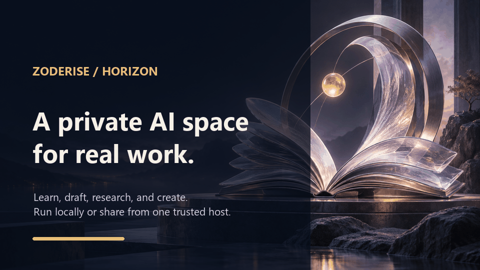
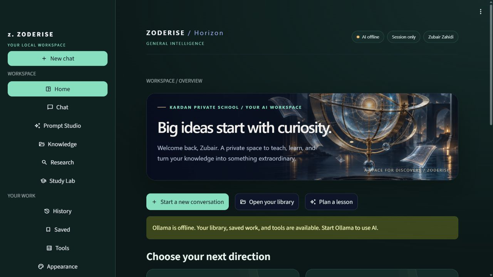
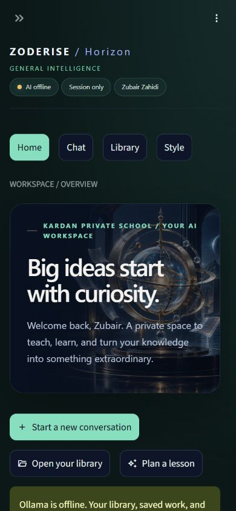
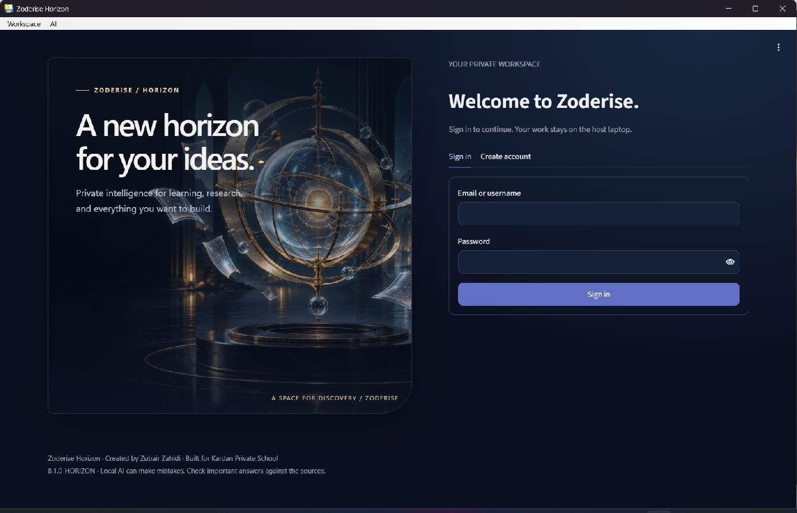
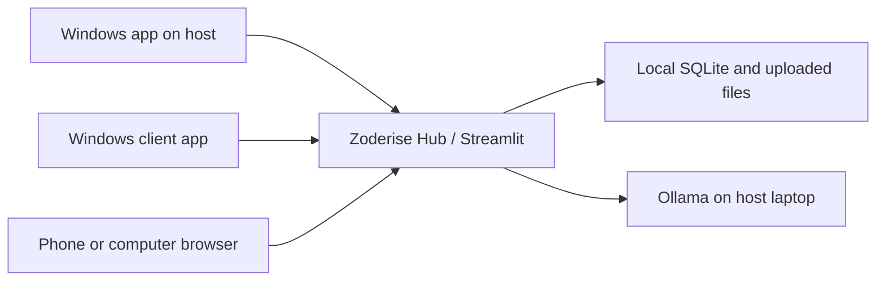

# Zoderise Horizon

**One private workspace for learning, research, and practical work.** Zoderise Horizon brings a local AI assistant, document research, study tools, and a customizable interface into a Windows app and browser experience. A host laptop can serve approved people on the same trusted network.

Created by **Zubair Zahidi** for **Kardan Private School**. Zubair customized the application workflows, prompts, and model parameters around existing Ollama models; this project does not claim that he trained or fine-tuned the underlying models.



> [!IMPORTANT]
> The AI runs through separately installed Ollama models on the host. The Windows app bundles the application, but it does **not** bundle those large models. AI responses require human review.

## See the workspace

| Desktop workspace | Mobile browser |
| --- | --- |
|  |  |

The desktop app opens in its own window; people using a phone open the host's address in their browser. Appearance preferences are saved per browser, so one person can use a compact phone layout and a different desktop layout.



## What it does

| Area | Workflow |
| --- | --- |
| **Chat** | Stream responses, attach images or documents, and choose session-only or saved conversation history. |
| **Prompt Studio** | Draft lesson plans, assessments, tutoring prompts, revision, and communications for human editing. |
| **Knowledge & Research** | Upload local documents, search their text, inspect retrieved passages, and ask document-grounded questions. Research uses uploaded material; it is not live web search. |
| **Study Lab** | Create summaries, practice questions, quizzes, and flashcards from selected material. |
| **Personal workspace** | Save useful outputs, reopen conversations, and customize colors, type, spacing, artwork, and motion on each device. |
| **Hub administration** | Approve accounts, review sessions and audit records, see the AI queue, and create verified local backups. |

The app also includes offline tools such as a calculator, unit conversion, hashing, and JSON formatting. AI generation needs Ollama; saved work and non-AI tools remain available when Ollama is offline.

## Choose how to run it

### Windows app

Download **Zoderise-Horizon-Hub-8.2-Windows-x64.exe** from [Releases](../../releases). Double-click it on Windows 10/11. Recipients do not need Python, Node.js, or the source folder. Microsoft Edge WebView2 Runtime is required. The first local account becomes administrator; no administrator password is bundled.

For local AI, install Ollama and use **AI → Set up models** in the app menu. Model downloads are separate and can use several gigabytes. See [Windows app notes](WINDOWS_APP.txt) and [model setup](DEPLOYMENT.md).

### Developer mode

Install Python 3.12 or newer and Ollama, then on Windows:

```bat
setup_windows.bat
start_ollama_and_zoderise.bat
```

Open `http://127.0.0.1:8501`. `setup_windows.bat` creates `.venv`, installs dependencies, and copies `.env.example` to `.env` only if `.env` does not exist. See [deployment](DEPLOYMENT.md) for Docker, model setup, and operational details.

### Share one host with other devices

On the Windows host, sign in as administrator and choose **Workspace → Enable Hub on this computer**. The **Admin → Hub access** page shows its LAN address and QR code. Other Windows users open their copy of the `.exe`, choose **Workspace → Connect to Hub**, paste that address, and sign in. Phone users open the address in a browser. Approve new accounts under **Admin → Users**.

Only the host needs Ollama. The host must stay awake, and devices must be on the same trusted network or a configured VPN. The built-in LAN address uses plain HTTP; use a trusted VPN or HTTPS reverse proxy for access beyond the local network. Do not forward the Streamlit or Ollama ports through an internet router. See [LAN and customization guide](LAN_AND_CUSTOMIZATION.md).



## Privacy and limits

- Uploaded documents, accounts, and saved work live on the **host**. Research searches uploaded documents only.
- SQLite and the verified backup ZIPs are **not encrypted by the application**. Protect the host disk and backup copies.
- The app drafts content in-app. It does not send email or integrate automatically with an LMS.
- The AI queue processes one answer at a time on the host GPU. Other users wait in a bounded queue.
- AI answers can be wrong. Teachers and professionals should verify important content against the displayed source passages and original documents.
- No measured time savings, grade improvements, or guaranteed accuracy are claimed.

See [security notes](SECURITY.md) for the threat model and recommended host controls.

## Project map

`app.py` is the Streamlit interface, `zoderise/` contains application modules, `desktop_launcher.py` powers the Windows window and Hub mode, `ZoderiseDesktop.spec` defines the executable build, and `assets/` and `docs/media/` contain local artwork and previews. Configuration starts with `.env.example`; never commit a real `.env`.

The automated checks cover authentication and data isolation, main UI workflows, the AI queue and backups, and a frozen executable launch with registration, sign-in, appearance, and Hub startup:

```bat
.venv\Scripts\python.exe tests\regression_test.py
.venv\Scripts\python.exe tests\ui_test.py
.venv\Scripts\python.exe tests\hub_reliability_test.py
```

For product decisions and deployment details, read [design and product plan](DESIGN_AND_PRODUCT_PLAN.md), [architecture](ARCHITECTURE.md), and [deployment](DEPLOYMENT.md).

---

**Zoderise Horizon** · Created by Zubair Zahidi · Built for Kardan Private School
